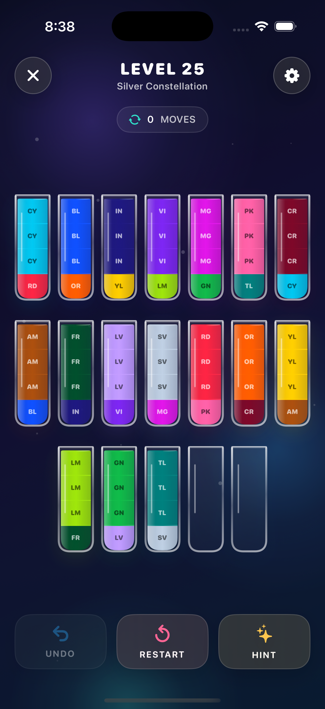

# Water Sort

Water Sort is a native SwiftUI puzzle game with 25 solver-validated levels, animated glass tubes, undo, solver-backed hints, persistent progression, haptics, sound effects, and accessibility support.

## Screenshot



## Run

Open `WaterSort.xcodeproj` in Xcode 26 or newer and run the `WaterSort` scheme on an iPhone simulator running iOS 17 or later.

## Test

```sh
xcodebuild test \
  -project WaterSort.xcodeproj \
  -scheme WaterSort \
  -destination 'platform=iOS Simulator,name=iPhone 16 Pro,OS=18.4'
```

The test suite covers move rules, multi-layer pours, capacity, undo, solved-state detection, progression persistence, solver behavior, and validation of all 25 levels.

## Architecture

- `Models`: immutable puzzle values and moves
- `Services`: level catalog, graph solver, persistence, haptics, and sound
- `ViewModels`: animation-safe gameplay orchestration
- `Views` and `Components`: responsive SwiftUI screens and the Chromatic Calm design system
